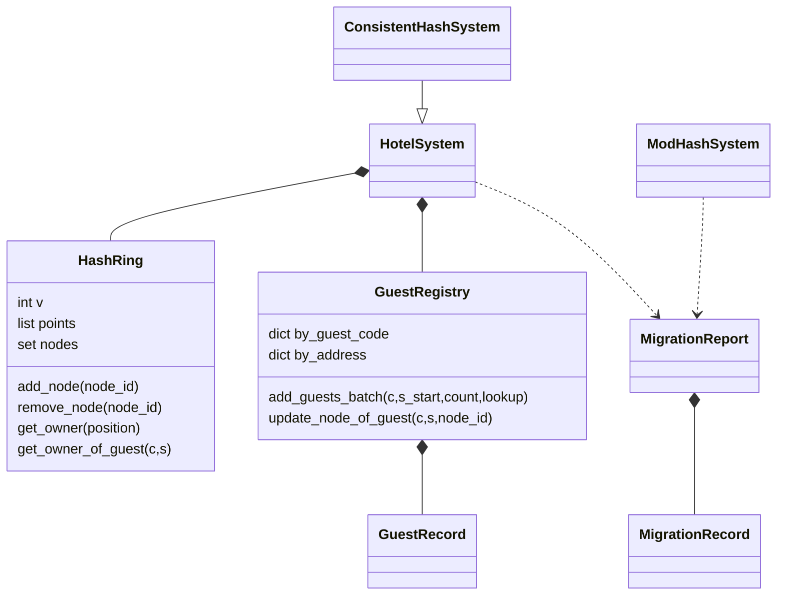

# Distributed Hilbert's Hotel: เอกสารเทคนิค

เอกสารประกอบโค้ดหลังแก้ไข วันที่ 12 พฤศจิกายน 2569 ใช้เป็นข้อมูลตั้งต้นสำหรับรายงานของกลุ่ม
รายชื่อ หน้าที่จริง สัดส่วนงาน และลายเซ็นต้องให้สมาชิกตรวจสอบและเติมเอง

## แบบข้อมูลและคลาส

HashRing เก็บจุด (position,node_id,j) แบบเรียงใน list เพื่อใช้ binary search และเก็บ set รหัสอาคารเพื่อป้องกันซ้ำ
GuestRegistry เก็บ dict สองทาง: (c,s)→GuestRecord และ (node_id,room_no)→(c,s) เพื่อค้นหาทั้งสองแบบในเวลาเฉลี่ย O(1)
GuestRecord เก็บ c,s,node_id,room_no โดยไม่มีห้องว่างที่สร้างรอไว้
HotelSystem เชื่อมข้อมูลและรายงาน; run_cli รับ input/แสดงผล; rebalance เป็นผู้หาผู้ย้ายและอัปเดตดัชนี
MigrationReport เก็บยอด/อัตรา/รายการ และ timings ของปรับวงแหวน/หาแขก/อัปเดต
ConsistentHashSystem สืบทอด HotelSystem และใช้ rebalance จริง จึงไม่มีกลไกย้ายอีกชุดในไฟล์ทดลอง

ตัวอย่างการรักษาข้อมูลให้สอดคล้อง: เมื่อแขก (1,2) ย้าย A→B เลขห้องยังเป็น 3; เปลี่ยน node_id ใน GuestRecord,
ลบ (A,3) จาก by_address และเพิ่ม (B,3)→(1,2) การค้นที่อยู่เดิมต้องไม่พบและที่อยู่ใหม่ต้องคืนรหัสเดิม

## เลขห้องและเหตุผลที่ไม่ซ้ำ

กำหนด a=c−1, b=s−1 และ n=a+b. ใช้ room_no=n(n+1)//2+b+1 ด้วยจำนวนเต็มล้วน
สำหรับ n คงที่ b วิ่ง 0..n จึงได้ช่วงเลขห้อง n(n+1)/2+1 ถึง (n+1)(n+2)/2
แต่ละช่วงต่อกันพอดีและไม่ทับกัน ภายในช่วง b ต่างกันก็ได้เลขต่างกัน จึงได้หนึ่งเลขห้องต่อหนึ่งคู่ (a,b)
และหนึ่งคู่ (c,s) เท่านั้น สูตรให้ (1,1)→1, (2,1)→2, (1,2)→3, (3,1)→4, (2,2)→5
เลขห้องขึ้นกับรหัสแขกล้วน ๆ จึงคงเดิมเมื่อย้ายอาคาร

## แฮชและวงแหวน

แปลงข้อความเป็น UTF-8, คำนวณ SHA-256, ใช้ 8 ไบต์แรกแบบ big-endian เป็นเลข 0..2^64−1
ข้อความปกติคือ guest:c:s และ node:node_id:j สำหรับ j=0..V−1 ไม่มี Python hash() เป็นแฮชหลัก
ในการทดลองเติม :salt ต่อท้ายทั้งข้อความแขกและจุดอาคารด้วยรูปแบบเดียวกันทุกรอบ
salt=None หมายถึงข้อความปกติไม่เติม suffix; การทดลองใช้ salt 0,1,2 ชัดเจน

เก็บทุกจุดเมื่อแฮชชนกันและเรียง tuple (position,node_id,j). ใช้ bisect_left หาจุดแรกที่ position>=ตำแหน่งแขก
ถ้าเกินจุดสุดท้าย วนกลับจุดแรก. การเพิ่ม/ลบไม่เปลี่ยนจุดอาคารอื่นหรือ V
เมื่อเพิ่มอาคาร ผู้ที่เปลี่ยนเจ้าของจึงย้ายเข้าอาคารใหม่เท่านั้น; เมื่อถอน ผู้ที่อยู่ที่อื่นไม่เปลี่ยนเจ้าของ
จำนวนย้ายนับรหัสแขกที่ node_id เปลี่ยนหนึ่งครั้งต่อคน และอัตราคือ R/K เมื่อ K>0
เมื่อ K=0 รายงานจำนวน 0 และไม่คำนวณอัตรา/CV

## Big-O จากโค้ดปัจจุบัน

N=จำนวนอาคารก่อนเปลี่ยน, V=จุดต่ออาคาร, M=NV, K=แขกก่อนเปลี่ยน, R=ผู้ย้าย, B=ขนาดกลุ่มที่เพิ่ม
ถือความยาวรหัส ขนาดจำนวนเต็มและการเปรียบเทียบคงที่; dict/set ใช้เวลาเฉลี่ย O(1)
การเรียง/แทรก list ด้านล่างระบุขอบเขตกรณีเลวร้าย ส่วนค่าจำนวนผู้ย้ายคาดหวังแยกจากเวลา

| งาน | ต้นทุนเวลา |
|---|---|
| สร้างวงแหวนเริ่มต้นด้วย insort M ครั้ง | O(M²) กรณีเลวร้าย |
| จัดแขกเริ่มต้น init_guests | O(K log(M+1)) ภายใต้สมมติฐาน dict เฉลี่ย; แผนชั่วคราว O(K) |
| เพิ่มแขกหนึ่งคน | O(log(M+1)) ภายใต้สมมติฐาน dict เฉลี่ย |
| เพิ่มกลุ่ม B คน | O(B log(M+1)); แผน/รายการรหัสชั่วคราว O(B) |
| ลบแขก | O(1) เฉลี่ย |
| ค้นผ่านรหัสแขกหรือที่อยู่ห้อง | O(1) เฉลี่ย |
| คำนวณอาคารจากวงแหวน | O(log(M+1)) กรณีเลวร้ายของ binary search |
| สร้างและเรียงรายการห้อง | O(K log(K+1)), ผลลัพธ์/พื้นที่เรียง O(K) |
| นับโหลดและรายงาน | O(N log(N+1)+K), พื้นที่ผลลัพธ์ O(N) |
| เพิ่มอาคาร: ปรับวงแหวน | O(V(M+V)) กรณีเลวร้ายของการแทรก list |
| เพิ่มอาคาร: หาแขกที่ย้าย | O(K log(M+V+1)); ตรวจทุกคนแบบ ก, สำเนารหัส O(K) |
| เพิ่มอาคาร: อัปเดตดัชนี | O(R) เฉลี่ย, รายการย้าย O(R) |
| ลบอาคาร: ปรับวงแหวน | O(M), list กรองชั่วคราว O(M) |
| ลบอาคาร: หาแขกที่ย้าย | O(K+R log(R+1)+R log(M+1)); สแกนข้อมูลและเรียงผู้พักในอาคารก่อนลบ |
| ลบอาคาร: อัปเดตดัชนี | O(R) เฉลี่ย, รายการผู้พักและย้าย O(R) |
| พื้นที่วงแหวน | O(NV); set รหัส O(N) |
| ข้อมูลแขกและดัชนี | O(K) แต่ละชุด รวมข้อมูลหลัก O(NV+K) |

CV ใช้ population std/mean. รายงานไม่ต้องสร้างและเรียงรายการห้องทุกอาคารเพื่อเพียงนับโหลดอีกต่อไป
หน่วยความจำของรายการผลลัพธ์และแผนย้ายต้องนับนอกเหนือจากข้อมูลหลักตามตาราง
Python int ขยายขนาดได้ ถ้ารหัสยาวขึ้น ต้นทุน hash/เลขห้อง/การเปรียบเทียบไม่เป็นค่าคงที่ตามสมมติฐานข้างต้น

## เปรียบเทียบการวิเคราะห์สองวิธี

| ประเด็น | hash mod N | Consistent Hashing |
|---|---|---|
| คำนวณอาคาร | O(1) เมื่อขนาดรหัสคงที่ | O(log M) |
| ปรับโครงสร้างเมื่อเพิ่ม | append O(1) amortized | O(V(M+V)) กรณีเลวร้าย |
| ปรับโครงสร้างเมื่อลบ | O(N) จาก list.remove | O(M) |
| หา/ปรับผู้ย้าย | วน K คน O(K)+O(R) เฉลี่ย | ตามขั้นตอนในตาราง Big-O; เพิ่มยังตรวจ K คน |
| จำนวนย้ายคาดหวังเมื่อเพิ่ม | ราว KN/(N+1) เมื่อแฮชสม่ำเสมอ | ราว K/(N+1) |
| จำนวนย้ายเมื่อถอน | วัดจริงด้วยรหัสอาคาร ไม่ใช่ดัชนี | คาดหวังราว K/N เมื่อแฮชสม่ำเสมอ |
| พื้นที่จัดเส้นทาง | O(N) | O(NV) |
| พื้นที่ข้อมูลรวม | O(N+K) | O(NV+K) |
| ความสมดุลโหลด | แบ่งเศษได้ใกล้เคียงกันเมื่อ hash ดี | ขึ้นกับช่วงวงแหวน; V เพิ่มช่วยลดความเบ้โดยทั่วไป |

ModHashSystem เก็บอาคารตามลำดับเพิ่ม, เพิ่มต่อท้าย, ถอนโดยรักษาลำดับที่เหลือ และเทียบ node_id จริง
การย้ายน้อยไม่ได้หมายความว่าคำสั่งใช้เวลาน้อยตามสัดส่วนเดียวกัน เพราะยังมีต้นทุนค้นหา K คนและแก้ดัชนี

## วิธีทดลองและหลักฐาน

A: K=1,000/10,000/100,000 โดย N=10,V=32. B: N=5/10/20 โดย K=10,000,V=32.
C: V=1/8/32 โดย N=10,K=10,000. ใช้ 10 ช่องทางกระจายใกล้เคียงกันและ salt 0,1,2
แต่ละกรณีเพิ่ม/ลบใน B เริ่มจากระบบเดิมใหม่ทั้งสองวิธี และถอนอาคารตำแหน่ง N//2 จากรายการเริ่มต้น
perf_counter วัดแยกขั้นตอนและไม่รวมรับข้อมูล/พิมพ์/เขียนไฟล์ ค้นหา 1,000 ครั้งแล้วหารต่อครั้ง
tracemalloc current/peak วัดแยกรอบ เป็นหน่วย MiB ที่ Python ติดตาม ไม่ใช่ RAM ของทั้ง process
CSV ดิบเก็บทุก salt/round; summary และกราฟรายงานมัธยฐานพร้อม min-max ไม่ใช้ค่าเฉลี่ยแทนมัธยฐาน

ผลเต็มอยู่ใน results/experiment_A.csv, experiment_B.csv, experiment_C.csv และ experiment_summary.csv
กราฟสามภาพอยู่ใน results/experiment_A.png, experiment_B.png, experiment_C.png
results/environment.json ระบุ Python/เครื่อง; results/test_results.log และ test_summary.json เป็นผล unittest

## ความถูกต้อง ข้อจำกัด และเอกสารส่งงาน

ชุด unittest หลังแก้ผ่าน 89/89 และชุดตรวจเพิ่มเติมภายนอกโปรเจกต์ผ่าน 32/32.
ตรวจสูตรและรหัสไม่ซ้ำ, batch overlap ไม่เปลี่ยนข้อมูล, จุดตรง/ระหว่าง/wraparound/collision,
ตัวอย่างเพิ่ม D ย้าย 2 คนและถอน B ย้าย 3 คน, V>1, room_no คงเดิม, ดัชนีสองทาง และ CSV ครบ
เมนูตรวจ input ผิด/ยังไม่เริ่มระบบ, count=0, K=0, path ผิด และรีเซ็ตสถานะ

ระบบทำงานในหน่วยความจำเครื่องเดียว ปิดโปรแกรมแล้วข้อมูลการเข้าพักไม่คงอยู่ เว้นแต่ส่งออก CSV
ไม่จำลองเครือข่ายหรือฐานข้อมูล; ไม่ได้เพิ่มฟังก์ชันอ่าน CSV กลับเพราะเป็นงานเพิ่มเติม
ผลเวลาเปลี่ยนตามภาระเครื่องและรุ่น Python; การรันจริงใช้ 3.13.9 และตรวจ syntax เป้าหมาย 3.10
ไม่ได้อ้างว่ารันทดสอบทุกเวอร์ชัน 3.10 ขึ้นไป ข้อมูลมีจำนวนจำกัดตามทรัพยากร ไม่มีความจุห้องที่กำหนดไว้ล่วงหน้า

รายงาน Word/PDF ที่เนื้อหาตรงกัน พร้อมรายชื่อ หน้าที่ สัดส่วนงานและลายเซ็นยังต้องจัดรูปเล่มก่อนส่ง
ข้ออ้างอิงหลักคือ PDF โจทย์ที่แนบไว้ในโฟลเดอร์ชั้นนอก; รายงานนี้อธิบายสิ่งที่ใช้จริงในโค้ด

## ตารางผลวัดหลังแก้ (มัธยฐาน 3 รอบ)

| A: K | จัดแขก (s) | รายการห้อง (s) | current (MiB) | peak (MiB) |
|---:|---:|---:|---:|---:|
| 1,000 | 0.006077 | 0.000571 | 0.452 | 0.460 |
| 10,000 | 0.060026 | 0.005273 | 3.841 | 4.411 |
| 100,000 | 0.773153 | 0.105164 | 42.117 | 48.863 |

| B: N | CH เพิ่ม | mod เพิ่ม | CH ถอน | mod ถอน |
|---:|---:|---:|---:|---:|
| 5 | 18.50% | 83.46% | 15.79% | 80.35% |
| 10 | 9.59% | 91.15% | 12.42% | 89.68% |
| 20 | 3.75% | 95.38% | 6.01% | 95.05% |

| C: V | CV | วงแหวน current (MiB) |
|---:|---:|---:|
| 1 | 1.173344 | 0.001925 |
| 8 | 0.394385 | 0.004885 |
| 32 | 0.183542 | 0.015074 |

ผลนี้แสดง CH ย้ายคนน้อยกว่าวิธี mod แต่เวลาไม่ได้ลดเป็นสัดส่วนเดียวกับจำนวนย้าย เพราะยังค้นหาผู้ได้รับผลกระทบ ค่า V ที่สูงขึ้นช่วยลด CV ในชุดนี้ และใช้พื้นที่วงแหวนเพิ่ม ค่าจำนวนย้ายไม่เท่าคาดหวังทุกครั้งเนื่องจากตำแหน่งช่วงวงแหวนและ salt; จึงต้องอ่าน min-max ประกอบ
